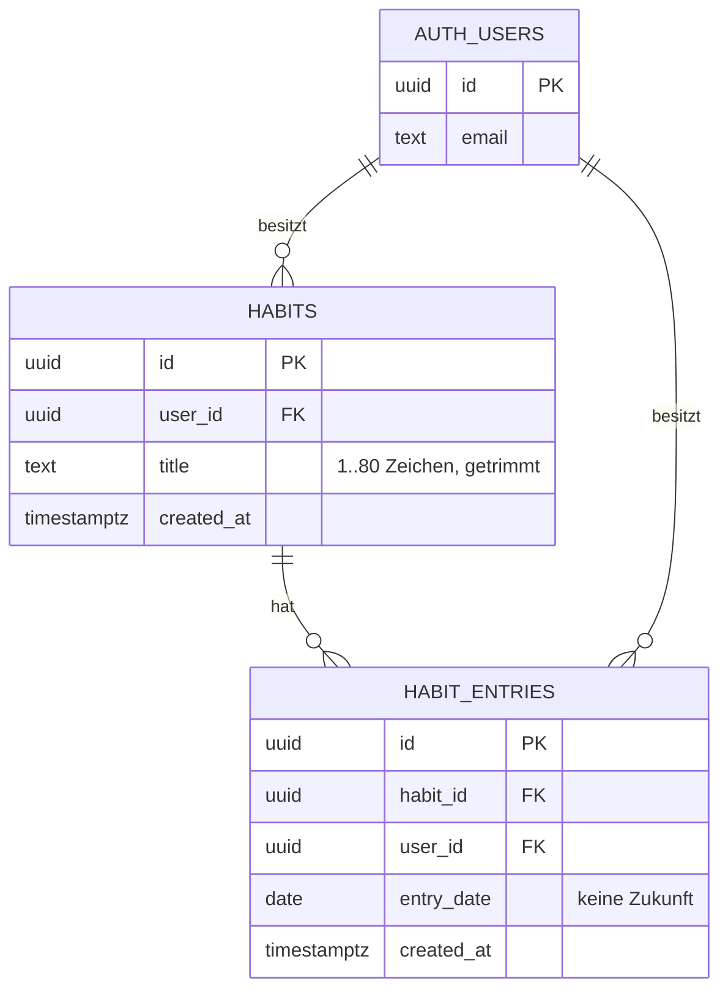

# Data Model

_Kanonisches Domänenmodell. Feature-Specs verweisen hierauf und erweitern es nur über
`supabase/migrations/*.sql` — kein Feature ändert Tabellen stillschweigend._

## Entities

### auth.users (Supabase-verwaltet)
Von Supabase Auth geführt, nicht von uns migriert. Die `id` (uuid) ist der einzige stabile
Identitätsanker der App; alle Nutzdaten hängen daran.

### habits
Eine Gewohnheit eines Nutzers — der Name, den er täglich abhaken will.

| Feld | Typ | Regeln |
|---|---|---|
| `id` | uuid | Primärschlüssel, `gen_random_uuid()` |
| `user_id` | uuid | NOT NULL, FK → `auth.users(id)` ON DELETE CASCADE; gehört dem Ersteller |
| `title` | text | NOT NULL, 1–80 Zeichen nach Trim, keine reinen Leerzeichen |
| `created_at` | timestamptz | NOT NULL, default `now()` |

### habit_entries
Ein Abhak-Vorgang: „Gewohnheit X wurde an Tag D erledigt". Ein Eintrag pro Gewohnheit und Tag.

| Feld | Typ | Regeln |
|---|---|---|
| `id` | uuid | Primärschlüssel, `gen_random_uuid()` |
| `habit_id` | uuid | NOT NULL, FK → `habits(id)` ON DELETE CASCADE |
| `user_id` | uuid | NOT NULL, FK → `auth.users(id)` ON DELETE CASCADE; denormalisiert für RLS ohne Join |
| `entry_date` | date | NOT NULL, default `current_date`; keine Zukunft |
| `created_at` | timestamptz | NOT NULL, default `now()` |

## ER-Diagramm

## Relationships

- `auth.users` 1 — n `habits` (`habits.user_id`)
- `habits` 1 — n `habit_entries` (`habit_entries.habit_id`)
- `auth.users` 1 — n `habit_entries` (`habit_entries.user_id`, redundant zu `habits.user_id`,
  damit die Policy ohne Join auf `habits` auskommt)

## Constraints & Invariants

- **Eindeutigkeit:** `unique (habit_id, entry_date)` — doppeltes Abhaken ist kein zweiter Eintrag,
  sondern ein No-Op (Upsert-Semantik im Datenzugriff).
- **Mandantentrennung:** `habits.user_id` und `habit_entries.user_id` sind unveränderlich; die
  Policy prüft `user_id = auth.uid()` auf **beiden** Tabellen (RLS aktiv, `FORCE` nicht nötig,
  da kein Service-Role-Zugriff aus der App).
- **Aufräumen:** Löscht Supabase den Auth-Nutzer, verschwinden Gewohnheiten und Einträge per
  `ON DELETE CASCADE` — kein Waisen-Datensatz bleibt zurück.
- **Zeit:** `entry_date` ist ein Kalendertag in der Zeitzone des Servers (`current_date`), bewusst
  ohne Nutzer-Zeitzonen-Logik im MVP.
- **Serie (Streak):** nicht gespeichert, sondern berechnet — aufeinanderfolgende `entry_date`-Werte
  endend heute oder gestern. Kein Zähler-Feld, das veralten könnte.
